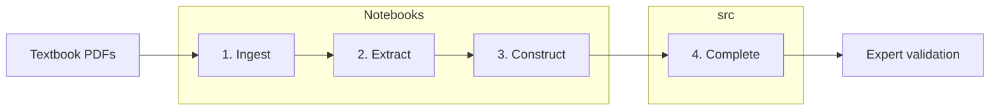

# LLM-Assisted Knowledge Graph Completion for Curriculum Analysis

Research artifact for an LLM-based pipeline that builds a knowledge graph (KG) from
Indonesian Grade XII science textbooks (Physics, Chemistry, Biology, Kurikulum Merdeka)
and completes it with cross-book relations.

## Pipeline



| Stage | Code | Output |
|---|---|---|
| 1-3. Ingest, extract, construct | `experiments/yhoga/TA_KG/*.ipynb` | `data/canonical/01_extraction`, `02_consensus` |
| 4. Complete (embed, ANN retrieve, prune, classify) | `src/completion.py` + `YhogaAdapter`, driven by `pages/5_Completion.py` | `data/canonical/03_completion` (125 `LINTAS_BUKU` edges) |
| Expert validation | `kg-review-app` submodule, `src/kg_review_redis.py` | `data/expert_feedback`, `data/completion_survey` |
| Analysis | `experiments/scripts/` | Thesis tables and figures |

Canonical data and provenance: [`data/canonical/README.md`](data/canonical/README.md).

## Setup

```bash
uv pip install -e .
cp .env.example .env   # GOOGLE_API_KEY, NEO4J_*_YHOGA
```

## Run completion

```bash
streamlit run pages/5_Completion.py
```

## Layout

```
src/                 completion stage (completion, schema_adapter, graph, cache, config)
pages/               completion UI
experiments/         notebooks (stages 1-3), analysis scripts, run archives
data/canonical/      paper data, one authoritative artifact per stage
data/expert_feedback expert validation exports
docs/                ontology (TTL), design notes
```
